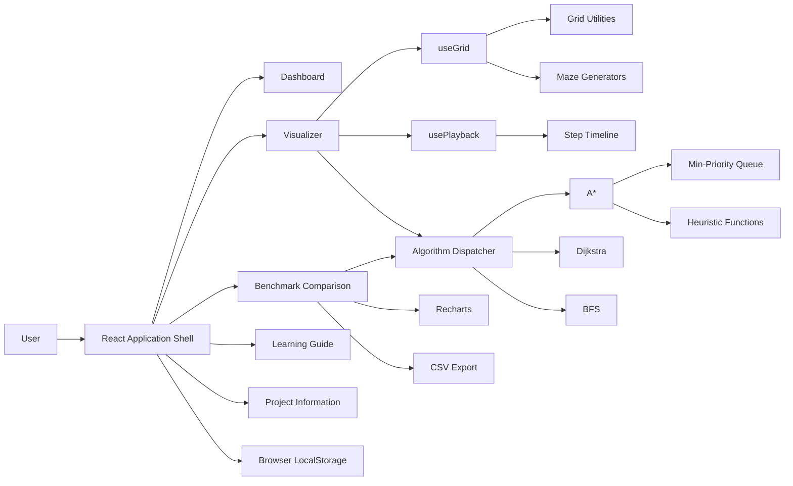
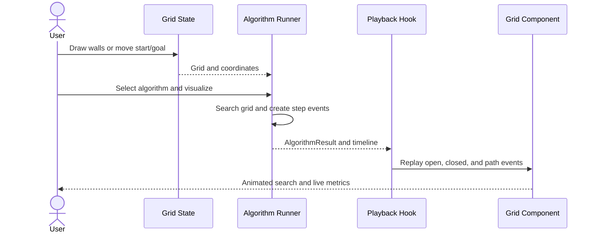

# A* Search Algorithm Visualizer

<p align="center">
  <strong>An interactive pathfinding laboratory for understanding informed and uninformed search algorithms.</strong>
</p>


## Table of Contents

- [Project Overview](#project-overview)
- [Problem Statement](#problem-statement)
- [Vision and Objectives](#vision-and-objectives)
- [Key Features](#key-features)
- [Target Users and Use Cases](#target-users-and-use-cases)
- [Implemented and Planned Features](#implemented-and-planned-features)
- [System Architecture](#system-architecture)
- [Application Workflow](#application-workflow)
- [Technology Stack](#technology-stack)
- [Project Folder Structure](#project-folder-structure)
- [Important Files](#important-files)
- [Frontend Architecture](#frontend-architecture)
- [Algorithms and Data Flow](#algorithms-and-data-flow)
- [API, Backend, Database, and Authentication](#api-backend-database-and-authentication)
- [Persistence and Integrations](#persistence-and-integrations)
- [Screenshots](#screenshots)
- [Development Prerequisites](#development-prerequisites)
- [Installation](#installation)
- [Environment Variables](#environment-variables)
- [Running the Project](#running-the-project)
- [Build and Production Deployment](#build-and-production-deployment)
- [Testing](#testing)
- [Coding Standards and Conventions](#coding-standards-and-conventions)
- [Debugging and Troubleshooting](#debugging-and-troubleshooting)
- [Security and Performance](#security-and-performance)
- [Versioning, Branching, and Releases](#versioning-branching-and-releases)
- [Contribution Guidelines](#contribution-guidelines)
- [Known Limitations](#known-limitations)
- [Roadmap](#roadmap)
- [FAQ](#faq)
- [Changelog](#changelog)
- [License](#license)
- [Credits and Contact](#credits-and-contact)
- [Final Summary](#final-summary)

## Project Overview

The A* Search Algorithm Visualizer is a browser-based educational application for exploring graph-search behavior on a configurable two-dimensional grid. It demonstrates A* search, Dijkstra's algorithm, and breadth-first search (BFS), while providing playback controls, maze generation, algorithm metrics, benchmark charts, and a built-in learning guide.

The project is implemented entirely in the browser. It has no application server, database, account system, external API dependency, or runtime network requirement.

## Problem Statement

The differences among search algorithms can be difficult to understand from formulas or pseudocode alone. Developers and students often need to see how an open set expands, how a closed set grows, how a path is reconstructed, and how heuristic guidance affects exploration.

This application addresses that problem by combining:

- An editable grid
- Deterministic step-by-step execution
- Live f(n), g(n), and h(n) values
- Adjustable playback
- Side-by-side benchmarks
- CSV benchmark export
- Academic explanations and viva-oriented questions

## Vision and Objectives

The project aims to make pathfinding algorithms understandable through direct experimentation. Its objectives are to:

- Demonstrate how A* combines path cost and heuristic estimates.
- Compare informed and uninformed search strategies under identical conditions.
- Explain algorithmic optimality and heuristic admissibility.
- Provide replayable, observable search execution.
- Allow educators to demonstrate the project during laboratory or viva sessions.
- Provide an approachable TypeScript codebase for algorithm and frontend studies.

## Key Features

- Interactive 18 x 32 grid with mouse and touch editing.
- Start and goal repositioning.
- Wall drawing and erasing.
- Configurable grid size from 8 to 40 rows and 12 to 60 columns.
- Random obstacle, recursive-division, and spiral maze generators.
- Preset scenarios: open terrain, slalom zig-zag, bottleneck, and U-trap.
- A* with Manhattan or Euclidean heuristics.
- Dijkstra and BFS implementations.
- Deterministic open, closed, and path event timelines.
- Play, pause, reset, single-step, and timeline scrubbing.
- Optional f/g/h score display.
- Live path, visited-node, open-node, and path-length metrics.
- Three-algorithm benchmark comparisons.
- Recharts visualizations and CSV export.
- Dark and light themes.
- Local browser persistence for theme, saved grids, and academic credentials.
- Built-in algorithm theory, pseudocode, worked examples, and viva questions.

## Target Users and Use Cases

| Audience | Typical use |
|---|---|
| Computer science students | Learn graph search and heuristic concepts |
| Educators | Demonstrate traversal and optimality interactively |
| Job candidates | Explain A* implementation and performance decisions |
| Open-source contributors | Extend algorithms, layouts, and visualizations |
| Academic evaluators | Review implementation, testing, and viva material |

Example use cases include demonstrating why Manhattan distance is admissible on a four-directional grid, comparing node exploration, reconstructing a shortest path, or saving a custom maze for a later session.

## Implemented and Planned Features

| Status | Feature |
|---|---|
| Implemented | A*, Dijkstra, BFS, Manhattan and Euclidean heuristics |
| Implemented | Interactive grid and deterministic playback |
| Implemented | Maze presets and saved grid configurations |
| Implemented | Benchmark charts and CSV export |
| Implemented | Theme and student metadata persistence |
| Implemented | Unit tests for queues, heuristics, paths, walls, and edge cases |
| Planned | Weighted A* |
| Planned | Diagonal movement and octile/chebyshev heuristics |
| Planned | Dynamic obstacle replanning |
| Planned | Additional automated UI and end-to-end tests |

## System Architecture



This is a layered client application:

- The React shell handles page routing and application-level UI.
- Pages compose feature-specific components.
- Hooks manage grid state, playback, themes, and browser persistence.
- Algorithm modules are pure functions that operate on grid data.
- Utilities generate grids and mazes or export benchmark records.
- Static data supplies presets and academic learning content.

## Application Workflow



Editing the grid increments a grid version. The visualizer invalidates the old result and reset playback state so stale path visualization cannot remain after a layout change.

## End-to-End User Flow

1. Open the dashboard and launch the visualizer.
2. Add or erase walls, or move the start and goal.
3. Select A*, Dijkstra, or BFS.
4. For A*, choose Manhattan or Euclidean distance.
5. Run the algorithm.
6. Watch the event timeline animate or control it manually.
7. Inspect path status and node statistics.
8. Open the comparison page to benchmark algorithms on a preset.
9. Export benchmark results as CSV.
10. Open the learning page for theory and viva material.

## Technology Stack

| Area | Technology | Purpose |
|---|---|---|
| UI framework | React 18 | Component-based browser interface |
| Language | TypeScript 5.7, strict mode | Type safety and maintainability |
| Build and development server | Vite 6 | HMR and production bundling |
| Styling | Tailwind CSS 3.4, PostCSS | Responsive and theme-aware UI |
| Icons | Lucide React | Interface iconography |
| Animation | Framer Motion | Page and UI transitions |
| Charts | Recharts | Benchmark bar charts |
| Testing | Vitest | Algorithm and utility unit tests |
| Persistence | Browser LocalStorage | Local configuration and saved data |

Utility dependencies include `clsx` and `tailwind-merge`.

## Project Folder Structure

```text
A-Search-Algorithm/
├── src/
│   ├── algorithms/
│   │   ├── __tests__/          # Vitest algorithm tests
│   │   ├── astar.ts            # A* implementation
│   │   ├── bfs.ts              # Breadth-first search
│   │   ├── dijkstra.ts         # Dijkstra's algorithm
│   │   ├── heuristics.ts       # Manhattan and Euclidean functions
│   │   ├── priorityQueue.ts    # Binary min-heap
│   │   └── index.ts            # Unified algorithm dispatcher
│   ├── components/             # Grid, controls, navigation, and UI components
│   ├── data/                   # Preset mazes and learning content
│   ├── hooks/                  # Grid, playback, theme, and storage hooks
│   ├── pages/                  # Dashboard and feature pages
│   ├── utils/                  # Grid, maze, and CSV helpers
│   ├── types/                  # Shared TypeScript types
│   ├── App.tsx                 # Shell and hash-based routing
│   ├── main.tsx                # React entry point
│   └── index.css               # Global and Tailwind styles
├── dist/                       # Generated production output
├── index.html                  # Vite HTML entry
├── package.json                # Scripts and dependencies
├── package-lock.json           # Reproducible npm dependency versions
├── tsconfig.json               # Strict application TypeScript configuration
├── tsconfig.node.json          # Node-side TypeScript configuration
├── vite.config.ts              # Vite React plugin and server settings
├── tailwind.config.js          # Tailwind theme and content paths
└── postcss.config.js           # PostCSS configuration
```

## Important Files

| File | Responsibility |
|---|---|
| `src/main.tsx` | Mounts React in strict mode |
| `src/App.tsx` | Navigation shell, hash routing, theme, and toast state |
| `src/pages/Visualizer.tsx` | Core grid editing and visualization experience |
| `src/pages/Comparison.tsx` | Benchmark execution, chart data, and CSV export |
| `src/pages/Learn.tsx` | Algorithm theory and viva guide |
| `src/pages/ProjectInfo.tsx` | Technical specification and editable academic metadata |
| `src/hooks/useGrid.ts` | Grid editing, resizing, mazes, and saved-grid operations |
| `src/hooks/usePlayback.ts` | Timeline replay and playback controls |
| `src/algorithms/astar.ts` | A* search and path reconstruction |
| `src/algorithms/dijkstra.ts` | Uniform-cost search |
| `src/algorithms/bfs.ts` | Queue-based breadth-first search |
| `src/algorithms/priorityQueue.ts` | Binary min-heap implementation |
| `src/types/index.ts` | Shared domain models and page types |
| `src/utils/csvExport.ts` | Browser CSV download implementation |
| `vite.config.ts` | Development server on port 3000 and React integration |

## Frontend Architecture

The UI uses feature-focused React components and custom hooks. `App` acts as the application shell and uses URL hashes for navigation, allowing routes such as `#dashboard`, `#visualizer`, `#comparison`, `#learn`, and `#project-info` without a router dependency.

The grid is represented as a two-dimensional array of `GridNode` objects. Each node contains coordinates, start/goal/wall flags, visualization state, and optional g, h, and f values.

Major UI groups include:

- Navigation: `Navbar` and `Sidebar`
- Grid editing: `Grid`, `Cell`, `Legend`, and `MazeControls`
- Playback: `Controls`
- Metrics: `StatCard`
- Notifications: `Toast`
- Context help: `Tooltip`

## Algorithms and Data Flow

All movement uses unit-cost orthogonal steps: up, right, down, and left. Diagonal movement is not currently implemented.

### A*

A* prioritizes nodes using:

```text
f(n) = g(n) + h(n)
```

- `g(n)` is the known cost from the start.
- `h(n)` is the estimated cost to the goal.
- The implementation uses a binary min-heap with lower `h(n)` as a secondary tie-breaker.
- Manhattan and Euclidean heuristics are both admissible under the project's movement model.
- The parent map reconstructs the path after the goal is reached.

### Dijkstra

Dijkstra uses the exact cost `g(n)` as priority and is implemented without a heuristic.

### BFS

BFS uses a FIFO queue and is suitable for the project's unweighted, unit-cost grid.

### Playback

Each algorithm returns an ordered `StepEvent` stream. `usePlayback` applies events cumulatively to a pristine grid copy, enabling forward playback, backward stepping, reset, pause, and timeline scrubbing without mutating historical algorithm state.

## API, Backend, Database, and Authentication

There is no backend, REST or GraphQL API, database, user account system, authentication, or authorization layer in the current implementation. All search execution occurs in the browser.

This means the project requires no server-side secrets and can be hosted as static files.

## Persistence and Integrations

The project uses browser LocalStorage through a typed `useLocalStorage` hook.

| Key | Content |
|---|---|
| `pathfinder-theme` | Selected dark or light theme |
| `pathfinder-saved-grids` | Saved dimensions, endpoints, and wall coordinates |
| `pathfinder-student-info` | Editable academic presentation metadata |

LocalStorage data is browser-specific and not synchronized across devices. Saved grids contain coordinates and walls, not the full visual step history.

There are no third-party runtime APIs or external integrations.

## Screenshots

Screenshots are not committed in the current repository. Use the running application to capture current dashboard, visualizer, comparison, learning, and project-information views for project submissions.

## Development Prerequisites

- Node.js 18 or newer
- npm 9 or newer
- A modern browser with LocalStorage and ES2020 support
- Git for source control

The project was verified with Node.js and npm available in the current environment.

## Installation

Clone the repository and install dependencies:

```bash
git clone https://github.com/jayaprakash72888-boop/A-search-algorithm.git
cd A-search-algorithm
npm install
```

## Environment Variables

No environment variables are required. The application does not read `.env` files or `import.meta.env` values.

## Running the Project

Start the Vite development server:

```bash
npm run dev
```

Vite is configured to open `http://localhost:3000/` and use port 3000.

If port 3000 is occupied, Vite reports or chooses another available port. Use the URL printed in the terminal.

## Build and Production Deployment

Create a production build:

```bash
npm run build
```

The build command runs strict TypeScript project compilation and then Vite bundling. Output is written to `dist/`.

Preview the generated build locally:

```bash
npm run preview
```

Deploy the contents of `dist/` to any static host, such as:

- GitHub Pages
- Netlify
- Vercel static deployment
- Azure Static Web Apps
- An ordinary web server or CDN

When deploying to a subdirectory, adjust Vite's `base` setting in `vite.config.ts` if assets are not rooted at `/`.

## Testing

Run the unit test suite:

```bash
npm test
```

The test suite currently covers:

- Binary min-heap ordering and tie-breaking
- Manhattan and Euclidean calculations
- Heuristic admissibility
- Open-grid shortest paths
- Wall-obstacle routing
- Start-equals-goal handling
- Unreachable goals
- Start and goal wall protection

Run strict TypeScript checking:

```bash
npm run lint
```

There is no end-to-end browser test suite or CI workflow in the repository at present.

## Coding Standards and Conventions

- Keep algorithm implementations pure where possible.
- Preserve strict TypeScript types.
- Use shared models from `src/types/index.ts`.
- Reuse `createEmptyGrid`, `cloneGrid`, and `toggleWall` for grid mutations.
- Keep React UI state in components or custom hooks.
- Use named exports for modules that may be imported by multiple features.
- Use accessible labels and visible states for interactive controls.
- Avoid adding runtime network dependencies for core algorithm behavior.

## Debugging and Troubleshooting

### Use the browser developer tools

Open DevTools and inspect the Console for LocalStorage read/write warnings and runtime errors.

### Reset persisted state

Clear the following LocalStorage keys in Application or Storage tools:

- `pathfinder-theme`
- `pathfinder-saved-grids`
- `pathfinder-student-info`

Alternatively, clear site data for the local application origin.

### Replay is stale or not updating

Edit or resize the grid and click **Visualize** again. Grid edits invalidate prior results and reset playback state.

### Port 3000 is already in use

Stop the existing process or allow Vite to choose another port. The terminal prints the active URL.

### Production build fails

Run:

```bash
npm run lint
npm test
npm run build
```

Resolve any strict TypeScript diagnostics before deploying.

## Security and Performance

The application stores only non-sensitive presentation and grid data in LocalStorage. It does not transmit user data to an external service.

Recommended security practices include:

- Serve production assets over HTTPS.
- Do not place credentials or private academic data in source-controlled files.
- Treat LocalStorage data as editable client-side data, not authoritative storage.
- Review dependencies with `npm audit` before release.

Performance characteristics:

- Heap insertion and removal are O(log n).
- Algorithms operate in memory on a bounded grid.
- Grid cloning supports deterministic timeline replay.
- Framer Motion, Recharts, and Lucide are included in the client bundle.
- The production build may report a large-chunk warning because charting, animation, and icon libraries are bundled together.

## Versioning, Branching, and Releases

The package version is `1.0.0`.

Recommended conventions:

- Use Semantic Versioning: `MAJOR.MINOR.PATCH`.
- Use `main` for stable, reviewed source.
- Use short-lived `feature/<topic>` branches for new work.
- Use `fix/<topic>` branches for defects.
- Tag releases as `v1.0.0`, `v1.1.0`, and so forth.

No formal release automation or GitHub Actions workflow is present in the repository.

## Contribution Guidelines

1. Fork the repository and create a focused branch.
2. Review the existing component and hook patterns.
3. Add or update tests for algorithm and behavior changes.
4. Run `npm run lint`, `npm test`, and `npm run build`.
5. Keep commits and pull request descriptions focused on one change.
6. Document any new page, setting, algorithm, or storage key in this README.
7. Do not commit generated `node_modules` or local build output.

## Known Limitations

- Movement is restricted to four orthogonal directions.
- No weighted, dynamic, bidirectional, or incremental replanning algorithms are implemented.
- Euclidean distance is available for comparison but is less informed for this movement model.
- Execution-time measurements can vary with browser scheduling and hardware.
- The benchmark dashboard uses fixed comparison grids rather than arbitrary visualizer state.
- LocalStorage is not a durable account-level storage mechanism.
- There is no formal CI/CD workflow or license file in the repository.
- The project has unit tests but no automated browser or end-to-end test suite.

## Roadmap

- Weighted A* with a configurable heuristic weight.
- Diagonal and any-angle movement.
- Bidirectional A* search.
- Dynamic obstacle replanning such as D* Lite.
- Shared, URL-based maze scenarios.
- Algorithm complexity and memory metrics.
- Component and end-to-end tests.
- Automated build and test workflows.
- Explicit project license and formal contribution documentation.

## FAQ

### Does A* always find the shortest path?

Yes on this 4-directional grid with a unit-cost movement model when using a consistent and admissible heuristic. The implementation uses Manhattan and Euclidean heuristics, which meet those properties for this project.

### Why is Manhattan the default?

Manhattan distance exactly estimates obstacle-free movement distance for up, down, left, and right transitions.

### Why might Euclidean expand more nodes?

Euclidean distance underestimates more than Manhattan on a 4-directional grid, so A* receives less directional guidance and may explore more nodes.

### Why might path lengths be identical?

All three algorithms find the shortest path on an unweighted grid. They differ mainly in search strategy and number of nodes evaluated.

### Is execution time a reliable performance benchmark?

Node and path statistics are more reproducible than wall-clock execution time because browser timing varies by machine and scheduling.

### Does the application need internet access?

After dependencies are installed and static assets are loaded, core operation is local and does not call a network API.

## Troubleshooting Guide

| Symptom | Check | Resolution |
|---|---|---|
| Blank page | Browser Console and terminal | Verify the dev server is running and open the printed URL |
| `npm install` fails | Node and npm versions | Upgrade Node.js and remove/reinstall `node_modules` if needed |
| Vite uses a different port | Terminal output | Open the URL Vite prints |
| Algorithm reports no path | Walls and endpoints | Remove walls separating the start from the goal |
| Visualization does not update | Existing result | Edit the grid or click Visualize again |
| Saved grids disappear | Different origin or browser | LocalStorage is origin- and browser-specific |
| Production assets return 404 | Static host base path | Configure Vite `base` or hosting rewrite settings |

## Changelog

### 1.0.0

- Initial educational release.
- Added A*, Dijkstra, and BFS visualization.
- Added grid editing, presets, saved grids, and playback controls.
- Added algorithm comparison, charts, and CSV export.
- Added learning, project information, and viva pages.
- Added Vitest unit coverage.

Future changes should be documented here or in a dedicated `CHANGELOG.md`.

## License

No license file or SPDX license declaration is currently included in the repository. Do not assume unrestricted reuse. Add a reviewed `LICENSE` file before publishing the project as open source.

## Credits and Contact

This project is maintained in the following repository:

- Repository: https://github.com/jayaprakash72888-boop/A-search-algorithm
- Owner: [jayaprakash72888-boop](https://github.com/jayaprakash72888-boop)

Primary technologies and their upstream projects include React, TypeScript, Vite, Tailwind CSS, Framer Motion, Lucide, Recharts, and Vitest.

For bugs or feature requests, use the repository's GitHub Issues page:

- https://github.com/jayaprakash72888-boop/A-search-algorithm/issues

## Final Project Summary

The A* Search Algorithm Visualizer is a complete client-side educational pathfinding application for constructing grids, executing A*, Dijkstra, and BFS, replaying search timelines, benchmarking algorithm behavior, and studying the relevant theory. It is ready for local development and static deployment, with strict TypeScript, automated unit tests, browser-local persistence, no backend dependency, and a clear structure for future algorithm and UI extensions.
